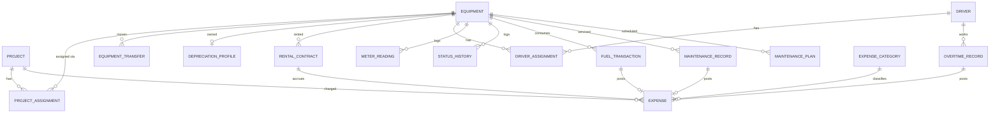

# Fleet & Equipment Management System — Phase 1: Analysis & Architecture

نظام إدارة حركة المعدات والمشروعات والسائقين

Status: **Approved for Phase 2** — financial rules confirmed (see §12 Decision log). Remaining `[ASSUMPTION]` items are non-financial and can be revisited.

---

## 1. Technology decisions

| Concern | Choice | Reason |
|---|---|---|
| Runtime | .NET 10 (ASP.NET Core, Kestrel bound to `127.0.0.1` only) | Primary stack; LTS |
| Frontend | Angular (standalone components, signals, strict TS) | Requested; Blazor evaluated below |
| UI kit | Angular CDK + Angular Material (heavily themed) + Tailwind CSS utilities | First-class RTL via `Directionality`, accessible, no visual "Material look" after theming |
| Charts | Apache ECharts (`ngx-echarts`) | Best RTL/Arabic text handling, rich chart types, fully offline bundle |
| Database | SQLite (WAL mode) via EF Core 10 | Local, zero-install |
| Migrations | EF Core Migrations, auto-applied at startup with pre-migration backup | Non-technical users never run commands |
| Validation | FluentValidation in Application layer | Centralized, testable |
| PDF | QuestPDF (RTL via `ContentFromRightToLeft`, bundled Arabic font) | Requested. Note: QuestPDF Community license is free for organisations under USD 1M annual revenue |
| Excel | ClosedXML (`RightToLeft = true` worksheets) | Requested |
| Logging | Serilog → rolling files in the data folder | Offline diagnostics |
| Fonts | IBM Plex Sans Arabic / Noto Naskh Arabic, **bundled** (no Google Fonts CDN) | Offline requirement |
| Packaging | Self-contained single-folder publish + Windows desktop host + Inno Setup installer | No .NET install needed on target PC |

### Angular vs Blazor evaluation
Blazor (Server or WASM) would remove the Node toolchain and let UI share C# DTOs. Angular is kept because: (a) it was the stated preference, (b) its RTL/component ecosystem and charting are more mature, (c) the API-first boundary enforces that **no business logic lives in the UI**. The cost (a Node build step) only affects developers, not end users — the compiled Angular bundle is embedded in the .NET publish output.

### Desktop delivery model
`Fleet.Desktop.exe` (WinForms + WebView2, ~200 lines) hosts the ASP.NET Core app in-process on a free loopback port and shows the Angular UI in a native window. WebView2 is preinstalled on Windows 10/11. Result: the user double-clicks a desktop icon and gets an app window — no browser tabs, no visible server, no console.
Fallback: if WebView2 is missing, open the default browser at the local URL.

Single-instance guard (named mutex) prevents two processes writing the same SQLite file.

---

## 2. Solution structure (Clean Architecture)

```
el7arka/
├─ docs/                              Architecture, decisions, user guide
├─ src/
│  ├─ Fleet.Domain/                   Entities, enums, value objects, domain calculators (pure, no EF/IO)
│  │  ├─ Entities/
│  │  ├─ Enums/
│  │  ├─ Calculations/                FuelConsumptionCalculator, DepreciationCalculator,
│  │  │                               RentalAccrualCalculator, OvertimeCalculator, CostAllocationCalculator
│  │  └─ Common/                      AuditableEntity, ISoftDeletable, DomainException
│  ├─ Fleet.Application/              Use cases: services, DTOs, validators, query models, interfaces
│  │  ├─ Abstractions/                IAppDbContext, IFileStorage, IClock, IReportExporter, IBackupService
│  │  ├─ Projects/ Equipment/ Assignments/ Drivers/ Fuel/ Maintenance/
│  │  ├─ Expenses/ Overtime/ Depreciation/ Dashboard/ Reports/ Settings/
│  │  └─ Common/                      Paging, filtering, sorting, Result<T>, mapping
│  ├─ Fleet.Infrastructure/           EF Core DbContext, configurations, migrations, seeding,
│  │                                  local file storage, QuestPDF/ClosedXML exporters, backup/restore
│  ├─ Fleet.Api/                      ASP.NET Core host: controllers (thin), error middleware,
│  │                                  serves Angular from wwwroot
│  ├─ Fleet.Desktop/                  WinForms + WebView2 shell, single-instance, tray/close handling
│  └─ Fleet.Web/                      Angular app
│     └─ src/app/
│        ├─ core/                     http, interceptors, i18n, toast, confirm dialog, layout shell
│        ├─ shared/                   ui kit: data-table, page-header, stat-card, filter-bar,
│        │                            date-range-picker, file-upload, empty-state, status-badge, money pipe
│        └─ features/                 dashboard, projects, equipment, drivers, assignments, fuel,
│                                     maintenance, expenses, overtime, depreciation, reports, settings
├─ tests/
│  ├─ Fleet.Domain.Tests/             Unit tests for all calculators (xUnit)
│  ├─ Fleet.Application.Tests/        Service + validation tests (SQLite in-memory)
│  └─ Fleet.Api.IntegrationTests/     WebApplicationFactory end-to-end workflows
├─ build/
│  ├─ publish.ps1                     Builds Angular → wwwroot, dotnet publish self-contained win-x64
│  └─ installer.iss                   Inno Setup: Program Files + desktop shortcut + uninstaller
└─ Fleet.sln
```

Dependency rule: `Domain ← Application ← Infrastructure ← Api ← Desktop`. Controllers only call Application services. Every financial calculation is in `Fleet.Domain/Calculations` or Application query services — never in Angular.

---

## 3. Data storage layout

Default data root: `%LOCALAPPDATA%\El7arka\` (configurable in Settings; relocation moves files and updates a small `appsettings.user.json` outside the data folder).

```
El7arka\
├─ data\fleet.db                      SQLite (WAL)
├─ attachments\yyyy\MM\{guid}.{ext}   invoices, equipment photos, driver photos, logo
├─ backups\fleet-backup-yyyyMMdd-HHmmss.zip
└─ logs\
```

Attachments are stored by GUID filename (original name kept in DB), with SHA-256 hash and size, and file-type + size validation (images, PDF; default max 15 MB).

---

## 4. Domain model

### 4.1 Common conventions
- All entities: `Id (int)`, `CreatedAt`, `UpdatedAt`, `CreatedBy`, `UpdatedBy` (UTC timestamps; dates shown in local time).
- Money: `decimal(18,2)` stored as SQLite TEXT via EF converter (no floating-point drift). Quantities `decimal(18,3)`. Meter readings `decimal(18,1)`.
- Business dates (`ExpenseDate`, `FuelDate`…) are `DateOnly`.
- Soft delete (`IsDeleted`, `DeletedAt`, `DeleteReason`) on all transactional records; global query filter. Master data uses `IsActive` (deactivate, never delete if referenced).
- `RowVersion` concurrency token on editable aggregates.
- `AuditLog` table records every create/update/delete with before/after JSON (needed for "authorized corrections").

### 4.2 Lookup / configuration tables
| Table | Key fields |
|---|---|
| `EquipmentCategory` | NameAr, NameEn, Icon, SortOrder, IsActive |
| `FuelType` | NameAr, NameEn, Unit (L / kWh / m³), IsActive |
| `ExpenseCategory` | NameAr, NameEn, **SystemKind** (None, Fuel, Maintenance, SpareParts, Rental, Overtime, Tolls, Tires, Oil), IsSystem, IsActive |
| `MaintenanceType` | NameAr, NameEn, DefaultIntervalKm?, DefaultIntervalDays?, DefaultIntervalHours?, IsActive |
| `LicenseType` | NameAr, NameEn, IsActive |
| `EquipmentStatusLabel` | Status (fixed enum), NameAr, NameEn, Color — labels configurable, semantics fixed |
| `CompanySettings` (singleton) | Name, Address, Phone, TaxNo, LogoAttachmentId, Currency (EGP), DateFormat, DefaultWorkingHours, FuelAnomalyThresholdPct, BackupSettings |
| `OvertimeRate` | DriverId? (null = default), HourlyRate, EffectiveFrom, EffectiveTo? |
| `DepreciationDefaults` | per EquipmentCategory: UsefulLifeYears, ResidualPct, Method |

`[ASSUMPTION]` Equipment status **semantics** are a fixed enum (`Available, Operating, UnderMaintenance, OutOfService, Inactive`) because utilization, downtime, and assignment rules depend on them. Users can rename/recolor them but not add statuses with new behaviour.

### 4.3 Core entities

**Project**
`Code (unique)`, `Name`, `Location`, `Description`, `StartDate`, `EndDate?`, `Status (Planned, Active, OnHold, Completed, Archived)`, `Notes`.

**Equipment**
`Code (unique)`, `Name`, `PlateNumber? (unique when set, normalized)`, `ChassisNumber? (unique when set)`, `CategoryId`, `Manufacturer`, `Model`, `Year`, `FuelTypeId`, `Ownership (Owned | Rented)`, `MeterType (Kilometers | EngineHours)`, `Status`, `InitialMeterReading`, `CurrentMeterReading` (denormalized, maintained by `MeterReadingService`), `MainImageId?`, `Notes`, `IsActive`.
- Owned → 1:1 `DepreciationProfile`
- Rented → 1:N `RentalContract`

**EquipmentImage** — EquipmentId, AttachmentId, SortOrder.

**DepreciationProfile** (owned only)
`PurchaseDate`, `PurchasePrice`, `ResidualValue`, `UsefulLifeMonths`, `Method (StraightLine)`, `DepreciationStartDate`, `DisposalDate?`.

**RentalContract** (rented only)
`ContractNo`, `Lessor`, `LessorPhone`, `StartDate`, `EndDate?`, `RateType (Monthly | Daily | Hourly | PerKm)`, `Rate`, `IncludesDriver`, `IncludesFuel`, `IncludesMaintenance`, `AttachmentId?`, `Notes`. No overlapping contracts per equipment.

**ProjectAssignment** (equipment ↔ project history; never deleted)
`EquipmentId`, `ProjectId`, `StartDate`, `EndDate?`, `StartMeter`, `EndMeter?`, `TransferId?`, `Notes`.
Invariant: at most one row with `EndDate IS NULL` per equipment (enforced by service + filtered unique index `UX_ProjectAssignment_Active (EquipmentId) WHERE EndDate IS NULL`), and no date overlap.

**EquipmentTransfer** — `EquipmentId`, `FromProjectId?`, `ToProjectId?`, `TransferDate`, `MeterReading`, `Notes`. One transaction closes the old assignment and opens the new one.

**EquipmentStatusHistory** — `EquipmentId`, `Status`, `FromDate`, `ToDate?`, `Reason`. Required for utilization and downtime reports.

**MeterReading** — `EquipmentId`, `ReadingDate`, `Value`, `Source (Initial, Fuel, Maintenance, Transfer, Expense, Manual, Correction)`, `SourceId?`, `IsCorrection`, `CorrectionReason?`. Single source of truth for odometer/hour-meter validation.

**Driver**
`FullName`, `NationalId? (unique when set)`, `Phone`, `Address`, `EmploymentStatus (Active, OnLeave, Suspended, Terminated)`, `HireDate`, `LicenseNumber`, `LicenseTypeId`, `LicenseExpiryDate`, `PhotoId?`, `Notes`, `IsActive`.

**DriverAssignment** — `DriverId`, `EquipmentId`, `StartDate`, `EndDate?`, `IsPrimary`, `Notes`. Many drivers per equipment allowed; same driver-equipment pair cannot overlap. A driver can be on several equipment simultaneously (decided).

### 4.4 Transactional entities

**FuelTransaction**
`EquipmentId`, `ProjectId` (defaults to active assignment on that date), `DriverId?`, `FuelTypeId`, `FuelDate`, `Quantity`, `PricePerUnit`, `TotalAmount`, `MeterReading?`, `IsFullTank`, `Station?`, `AttachmentId?`, `Notes`.
Validation: `Quantity > 0`, `TotalAmount ≥ 0`, `|Quantity × Price − Total| ≤ 0.05` (user enters any two, third computed).

**MaintenanceRecord**
`EquipmentId`, `ProjectId`, `MaintenanceTypeId`, `MaintenanceDate`, `MeterReading?`, `Description`, `Workshop`, `PartsCost`, `LaborCost`, `OtherCost`, `TotalCost (computed)`, `DowntimeDays?`, `NextDueDate?`, `NextDueMeter?`, `AttachmentIds`, `Notes`.

**MaintenancePlan** (reminders) — `EquipmentId`, `MaintenanceTypeId`, `IntervalKm?`, `IntervalHours?`, `IntervalDays?`, `LastDoneDate`, `LastDoneMeter`, `IsActive`. Recalculated whenever a matching maintenance record is saved. Status: `Ok / DueSoon / Overdue` (whichever trigger hits first).

**OvertimeRecord**
`DriverId`, `EquipmentId?`, `ProjectId`, `WorkDate`, `NormalHours`, `OvertimeHours`, `HourlyRate` (snapshotted from `OvertimeRate` on save, editable), `Amount (computed)`, `Description`, `ApprovalStatus (Pending, Approved, Rejected)`, `ApprovedAt?`.

**Expense** — the single **cost ledger** (see §5.1)
`EquipmentId?`, `ProjectId?`, `CategoryId`, `ExpenseDate`, `Amount`, `Quantity?`, `UnitPrice?`, `MeterReading?`, `Description`, `SourceType (Manual, Fuel, Maintenance, Overtime, Rental)`, `SourceId?`, `Notes`, attachments.
Ledger rows with `SourceType ≠ Manual` are created/updated/soft-deleted **only** by their source service and are read-only in the Expenses screen.

**Attachment** — `OriginalName`, `StoredPath`, `ContentType`, `SizeBytes`, `Sha256`, `OwnerType`, `OwnerId`, `UploadedAt`.

**BackupLog**, **AuditLog**.

### 4.5 ER overview



---

## 5. Key business rules & calculations

### 5.1 One cost ledger — no double counting
Fuel, maintenance, approved overtime and rental each **post exactly one ledger row per source record** into `Expense` (linked by `SourceType + SourceId`). All financial totals (dashboard, project, equipment, reports) are computed from `Expense` only, by one `CostQueryService`. The operator never enters fuel or maintenance twice; the Expenses screen shows them as linked read-only rows.
**Decided:** maintenance posts two ledger rows — `PartsCost` → Spare Parts, `LaborCost + OtherCost` → Maintenance (zero-amount rows are skipped). "Maintenance cost" reports sum both rows by `SourceType = Maintenance`.

### 5.2 Cash vs non-cash
- **Cash costs** = sum of `Expense` ledger.
- **Depreciation** = calculated on the fly by `DepreciationCalculator`, never stored in `Expense`, never included in "total operating expenses". Shown separately; "Total cost of ownership" = cash + depreciation, explicitly labelled.

### 5.3 Fuel consumption (full-tank-to-full-tank method)
For equipment `e`, with fuel transactions ordered by (date, meter):
- A **segment** runs from one full-tank fill with a valid meter reading (F₀) to the next full-tank fill with a valid meter reading (F₁).
- `Distance = Meter(F₁) − Meter(F₀)`
- `Fuel = Σ Quantity of every fill after F₀ up to and including F₁` (partial fills in between are included)
- `km/L = Distance / Fuel`; `L/100km = Fuel / Distance × 100`; for hour-meter equipment: `L/hour = Fuel / Hours`.
- A segment is marked **Invalid / insufficient data** (excluded from averages, shown with a reason) if: no previous full fill, missing meter in either end, distance ≤ 0, a meter correction occurred inside the segment, or a fill without meter exists inside the segment.
- Equipment average = `Σ distance / Σ fuel` over valid segments (weighted, not mean of ratios).
- **Anomaly**: segment consumption worse than equipment's trailing average by more than `FuelAnomalyThresholdPct` (default 25%), and fleet-level outliers per category.

Example from the requirements: 10,000 → 10,500 km, 100 L ⇒ 500 km, 5 km/L, 20 L/100km. ✔ (unit test)

### 5.4 Meter reading validation
New reading for date `d` must be ≥ greatest reading before `d` and ≤ smallest reading after `d` (supports back-dated entries). Violations are rejected unless saved as a **Correction** with a mandatory reason (logged in `AuditLog`). `CurrentMeterReading` = latest reading by date.

### 5.5 Depreciation (straight-line, monthly)
- `Depreciable = PurchasePrice − ResidualValue`
- `Monthly = Depreciable / UsefulLifeMonths`; `Annual = Monthly × 12`
- `Accumulated(asOf) = min(Monthly × MonthsElapsed, Depreciable)`
- `BookValue = PurchasePrice − Accumulated`
- **Decided: daily proration.** Useful-life window = `[StartDate, StartDate + UsefulLifeMonths)`; `TotalDays` = days in that window; `Accumulated(asOf) = Depreciable × DaysElapsed / TotalDays` (capped at `Depreciable`). Depreciation for any period (month, year, custom range) = `Depreciable × DaysInPeriodWithinWindow / TotalDays`. "Monthly" and "Annual" shown on profiles are the nominal `Depreciable / UsefulLifeMonths` and `× 12`.
- Stops at disposal date or end of useful life. Rented equipment never has a profile.

### 5.6 Rental cost
**Decided:** `RentalAccrualService` generates one ledger row per contract per calendar month (idempotent, keyed by contract + month; runs on startup and on demand; only for months fully elapsed or the current month to date — configurable).
- Monthly rate: `Rate × DaysActiveInMonth / DaysInMonth`.
- Daily rate: `Rate × DaysActiveInMonth`.
- Hourly / PerKm: `Rate × usage`, where usage = meter delta from `MeterReading` within the month; if readings are insufficient the month is flagged "pending usage" and the user confirms/enters the usage before posting.
- A month split across projects posts one row per project, prorated by assignment days (§5.8).

### 5.7 Overtime
`Amount = OvertimeHours × HourlyRate`. Rate resolution on `WorkDate`: driver-specific `OvertimeRate` → default rate (both effective-dated). **Decided:** only **Approved** records post to the ledger; rejecting or un-approving reverses the posting.

### 5.8 Cost attribution to projects
Every ledger row carries the project the equipment was assigned to on the expense date (auto-filled, overridable). Depreciation per project = monthly depreciation prorated by the number of days the equipment was assigned to that project in the period.

### 5.9 Utilization & downtime
From `EquipmentStatusHistory` over the period: `Utilization % = Operating days / (period days − Inactive days)`; `Downtime = UnderMaintenance + OutOfService days`.

### 5.10 Assignment & transfer rules
- Transfer = single DB transaction: close current assignment (EndDate = transfer date, EndMeter), create new assignment, create `EquipmentTransfer`, insert `MeterReading`.
- Cannot assign equipment with status `OutOfService` / `Inactive`; assigning a status `Available` unit switches it to `Operating` (configurable).
- Archiving a project requires releasing or transferring its active equipment.
- Back-dated transfers must not overlap existing history.

### 5.11 Deletion policy
Master data: deactivate only once referenced. Transactions: soft delete with reason. History tables (assignments, transfers, status history, meter readings): never deleted; corrected via correction entries.

---

## 6. API design

REST, JSON, `/api/v1/...`, DTOs only. Standard list query: `?page=&pageSize=&sort=field:asc&search=&from=&to=&projectId=&equipmentId=&driverId=&categoryId=`. Errors as RFC 7807 `ProblemDetails` with field-level validation errors (localized Arabic messages).

Main resources: `projects`, `equipment` (+ `/transfer`, `/status`, `/meter-readings`, `/images`, `/summary`), `assignments`, `drivers` (+ `/assignments`), `fuel` (+ `/consumption`), `maintenance` (+ `/plans`, `/upcoming`), `expenses`, `overtime` (+ `/approve`), `depreciation`, `dashboard`, `reports/{key}` (+ `/pdf`, `/xlsx`), `attachments`, `settings/*`, `backup`.

---

## 7. UI/UX system

- RTL Arabic default (`dir="rtl"`, `lang="ar"`); all text via translation keys (`@ngx-translate` or Angular i18n runtime) so English can be added.
- Tokens: background `#FAFAF9`, surface `#FFFFFF`, subtle `#F4F4F5`, border `#E4E4E7`, text `#18181B`, muted `#71717A`, accent `#18181B` (charcoal), success `#15803D`, warning `#B45309`, danger `#B91C1C`. Radius 8px, 1px borders, almost no shadows.
- Typography: IBM Plex Sans Arabic, tabular numerals for money/meters.
- Shell: collapsible right-side sidebar (12 entries from the requirements), top bar (global search, date-range context, backup status), breadcrumbs.
- Reusable components: `DataTable` (server paging/sort/filter, column chooser, export menu), `FilterBar`, `StatCard`, `ChartCard`, `PageHeader`, `FormField`, `MoneyInput`, `MeterInput` (shows last reading), `FileUpload` (drag-drop, preview), `StatusBadge`, `ConfirmDialog`, `Toast`, `EmptyState`, skeleton loaders.

---

## 8. Reports catalogue

Each report = one Application query (shared with the on-screen table) + one `ReportDefinition` (columns, formats, totals) consumed by both the PDF and Excel exporters, so screen, PDF and Excel always show identical numbers.

Equipment: inventory, by project, by ownership, by status, assignment history.
Financial: operating expenses, fuel, maintenance, spare parts, rental, overtime, depreciation schedule, total cost per equipment, total cost per project.
Operational: fuel consumption, meter readings, utilization, maintenance schedule (upcoming/overdue), downtime, driver assignments, license expiry.

---

## 9. Backup & restore

- Manual backup: SQLite online backup API (consistent while running) + attachments → one `.zip` with `manifest.json` (app version, schema version, counts, hashes).
- Automatic: daily on first launch of the day + before every migration; retention N (default 14).
- Restore: validate manifest → auto-backup current state → replace DB and attachments → restart host.
- Full export/import = same zip format, choosable location (USB, network share).

---

## 10. Security & users

**Decided:** single-PC app with local login (two roles: **Admin** – settings, corrections, approvals, restore; **User** – data entry). Passwords hashed (PBKDF2). Kestrel bound to loopback only.

---

## 11. Testing strategy

- Domain unit tests: fuel segments (full/partial/missing meter/correction), depreciation (start convention, cap at residual, disposal), rental proration, overtime rate resolution, cost allocation, maintenance due status.
- Application tests: transfer transaction, overlap prevention, meter validation, ledger posting/reversal (no double counting).
- Integration tests: create project → equipment → assign → fuel ×3 → maintenance → report totals match dashboard; backup → restore round-trip.

---

## 12. Decision log

| # | Topic | Decision |
|---|---|---|
| 1 | Rental cost | Auto-generated monthly ledger rows from contract rate, prorated by days (§5.6) |
| 2 | Maintenance posting | Split: parts → Spare Parts, labor/other → Maintenance (§5.1) |
| 3 | Meter type | Per equipment: Kilometers or EngineHours |
| 4 | Depreciation convention | Daily proration (§5.5) |
| 5 | Overtime | Approved only; default + per-driver effective-dated rates (§5.7) |
| 6 | Users | Local login, Admin + Data-entry roles (§10) |
| 7 | Driver concurrency | A driver may be assigned to several equipment at once |
| 8 | Project attribution | Fixed costs (depreciation, rent) prorated by assignment days (§5.8) |
| 9 | Toolchain | User installs .NET 10 SDK manually |
| 10 | Manual expenses | Categories of kind Fuel, Maintenance, Rental, Overtime cannot be entered manually (only via their modules) to prevent double counting. Spare parts, oil, tires, tolls etc. can. |
| 11 | Partial fills without meter | Do not invalidate a fuel segment — their quantity is still added to the next full-to-full segment |
| 12 | Assignment boundaries | A transfer on date D closes the previous assignment on D−1 so no day is counted for two projects |
| 13 | Historical entry | The first status span of newly registered equipment extends backward when older data (e.g. a back-dated assignment) is entered |
